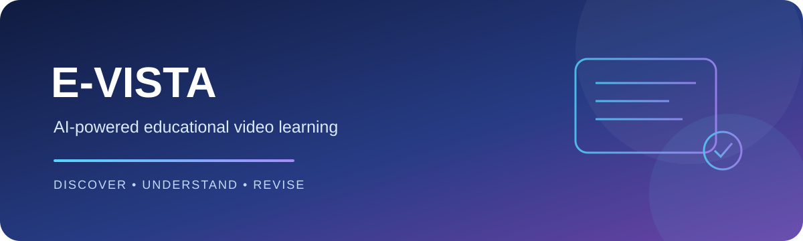
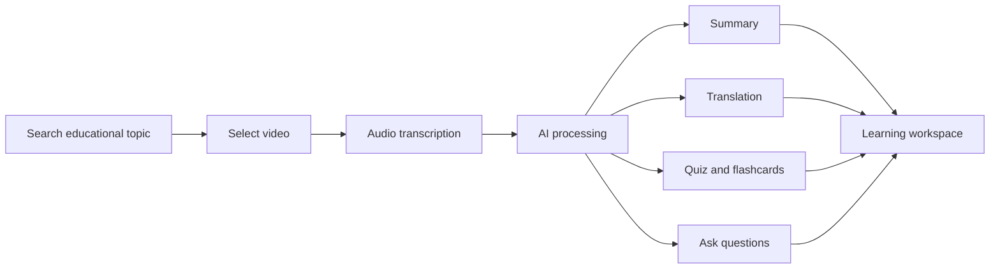

# E-VISTA
<p align="center"></p>

<p align="center">
  
  
  
  
</p>

<p align="center"><b>Discover. Understand. Revise.</b><br/>An AI-assisted learning workspace that turns educational videos into useful study material.</p>

## ✨ Project overview
E-VISTA (Educational Video Insight, Search, Translation & Abstraction) helps learners move from watching a lecture to actively understanding and revising its content. It brings video discovery, transcription and AI-powered study tools into one workflow.

## 🚀 Key features
| Feature | What it helps you do |
|---|---|
| 🔎 Video discovery | Find educational YouTube videos by topic |
| 🎙️ Speech transcription | Convert video audio into text with Whisper |
| 🧠 AI summaries | Get concise learning summaries with Gemini |
| 🌐 Translation | Make learning content easier to access |
| 📝 Quiz & flashcards | Practise and revise important concepts |
| 💬 Content Q&A | Ask questions about the learning material |
| 📊 Learning dashboard | Review learning activity and progress |

## 🧩 How it works


## 🛠️ Technology stack
| Layer | Tools |
|---|---|
| Frontend | React, Tailwind CSS |
| Backend | Python, FastAPI |
| Speech-to-text | OpenAI Whisper |
| Generative AI | Google Gemini |
| Database | SQLite |

## ⚡ Run locally
See the detailed setup guide in **[evista-2/README.md](./evista-2/README.md)**.

```bash
git clone https://github.com/likhithds1si23cs099-bit/Evista.git
cd Evista/evista-2/backend
python3 -m venv .venv
source .venv/bin/activate
pip install -r requirements.txt
cp .env.example .env
```

Add your Gemini API key to the local `.env` file, then start the backend:

```bash
uvicorn main:app --reload --port 8000
```

Open **http://localhost:8000**. Refer to the detailed guide for configuration, frontend startup and troubleshooting.

## 📂 Repository layout
```text
Evista/
├── evista-2/
│   ├── backend/
│   ├── .vscode/
│   └── README.md
└── README.md
```

## 🔐 Security
- Store API keys in your local `.env` file.
- Never commit secrets, credentials or private tokens.
- Keep `.env.example` limited to variable names and safe placeholders.

---
<p align="center"><b>Built to make learning from educational videos more interactive and accessible.</b></p>
